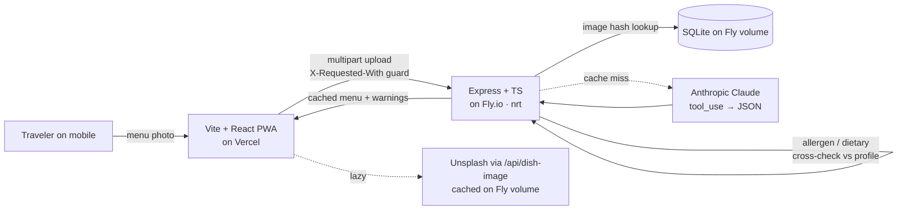

# As Your Dish

> Decode foreign-language menus before you order. Photograph a menu → every dish identified, translated idiomatically, explained with cultural context, broken down by ingredients, scored on six flavor axes, and **flagged red when it conflicts with the allergies and dietary preferences you declared up front.**
>
> 帮中文母语者在境外旅行/工作时看懂外文菜单的 PWA。
>
> **Live demo → [as-your-dish.vercel.app](https://as-your-dish.vercel.app)** · [中文版 README](./README.zh.md)


A weekend-and-evenings portfolio project. Built solo over ~10 working days as an end-to-end study in mobile-first AI product engineering: tool-constrained LLM I/O, multi-provider cost governance, safety-first health-data UX, and operating a real public service on a personal budget.

The code is intentionally written in a way that explains itself to a reader who is interviewing the author — `// WHY: ...` comments mark every non-obvious design decision, and the git log uses Conventional Commits from the first commit.

---

## Demo flow at a glance

| Take a photo | See the menu | When it's risky |
|---|---|---|
|  |  |  |

| Flavor radar | Profile preferences | History |
|---|---|---|
|  |  |  |

If you don't want to upload your own menu, the **"Try a sample"** button on the home page loads one of three curated example menus (Chinese / Italian / Japanese) without spending an LLM call.

---

## Architecture



- **Frontend** — React + Vite + TypeScript + Tailwind + PWA. Mobile-first; tested at iPhone SE width (375px).
- **Backend** — Node 22 + Express + TypeScript on Fluid Compute. Multer for image uploads, Drizzle ORM + libsql/SQLite, `express-rate-limit` for cost control, `helmet` for response headers.
- **Shared** — A `shared/` workspace exports Zod schemas. The `Dish` shape has a single source of truth consumed by both ends, including the JSON schema fed into Claude's `tool_use`.
- **LLM** — Provider-neutral `LLMProvider` interface with three adapters: Anthropic Claude (full implementation), OpenAI GPT-4o (skeleton + pricing), Google Gemini (skeleton + pricing). Selectable via `LLM_PROVIDER` env var; users can also supply their own Anthropic key in the browser to bypass the operator's quota.

---

## Tech stack

| Layer | Choice | Why |
|---|---|---|
| Frontend framework | Vite + React + TypeScript | Fast HMR, low bundle ceiling, type-checked all the way to the API boundary. |
| Styling | Tailwind CSS | Mobile-first utilities; encourages low-CSS-coupling components. |
| Frontend state | React Query + Zustand | Server state with caching/retries (React Query) cleanly separated from auth/profile UI state (Zustand). |
| Forms | react-hook-form + zod | Same Zod that validates the API can validate the form. |
| Charts | Recharts | Radar chart only; small, declarative, works inside React tree. |
| Image compression | browser-image-compression | Long-edge resize on-device before upload; cuts request body by 80%+. |
| PWA | vite-plugin-pwa | Manifest + service worker generated, supports "add to home screen" on iOS. |
| Backend framework | Express on Node 22 LTS | Boring + boring is good; pairs with Fly Fluid Compute. |
| Validation | Zod | Single schema → request validation, tool input_schema for Claude, TS types for clients. |
| ORM | Drizzle | Closest to raw SQL; migrations are checked-in `.sql` files; no decorator magic. |
| Database | SQLite via @libsql/client | Single file on a Fly volume; daily traffic for this project doesn't justify Postgres. |
| LLM | Anthropic Claude Sonnet 4.6 via `tool_use` | Strong vision + the most reliable structured-output mechanism I tested. |
| Hosting (frontend) | Vercel | Free for personal; rewrites act as a thin reverse proxy to the API. |
| Hosting (backend) | Fly.io (nrt) | Fluid Compute = real Node; persistent volume = real SQLite; cheap when idle. |

---

## Design highlights

### 1. `tool_use` for hard-constrained structured output

The whole product hinges on getting the same `Dish` shape back every time: original name, idiomatic Chinese translation, ≤100-character description, ingredient list, FDA-9 allergen set, dietary tags, 6-axis flavor scores, confidence number. Free-form text would require regex parsers downstream, and the first cell that misparses corrupts the rest of the card.

The Claude adapter compiles the shared Zod schema into a JSON schema and passes it as a `tool_use` definition with `tool_choice: { type: "tool", name: "submit_menu_analysis" }`, which forces the model to call exactly that tool. On the rare occasions the model still returns a stringified array inside `tool_use.input` instead of a native array — a documented quirk of Sonnet 4.6 — the adapter shallow-parses string values that look like JSON before Zod validation, and falls back to `[]` for optional metadata fields when the inner JSON is malformed. If validation still fails, the adapter retries once with the Zod errors echoed back to the model.

Net result: a 10–15-dish menu round-trips end-to-end with a single LLM call ≥ 95% of the time, no regexes, and any parsing failure is surfaced as a typed error the route handler can convert to a friendly 5xx.

### 2. Two-layer allergen detection — "wrong but safe" beats "right but quiet"

This is a health-sensitive app: missing a shellfish ingredient on a card given to someone with a shellfish allergy is far worse than over-flagging.

So the LLM detects allergens, and then a **second** pass runs server-side: a bilingual keyword table (`shrimp` / `虾` / `prawn` / `lobster` / `crab` / `螃蟹` → `shellfish`, ~30 entries across FDA-9) walks every `ingredient.name` of every returned dish. If the keyword matches but the LLM left the allergen tag off the dish, the backend **adds** it and appends a `warnings` entry like "系统补充检测：虾 含 shellfish". This is decorate-don't-replace: the LLM's tags are never removed.

A separate decoration step then matches each dish against the logged-in user's saved profile (allergens + dietary tags) and emits `hits` / `hitDietary` arrays consumed by the frontend's red banner UI. The contract is asymmetric on purpose: if the post-processor and the LLM disagree, the card escalates to warning.

### 3. Provider-neutral LLM abstraction + bring-your-own-key

The `LLMProvider` interface lives in [`backend/src/services/llm/provider.ts`](./backend/src/services/llm/provider.ts) and intentionally exposes no vendor-specific vocabulary — no `tool_use`, no `responseSchema`, no `function_calling`. Adapters absorb that mess internally. Today the Anthropic adapter is real, OpenAI and Gemini are typed skeletons with their pricing tables filled in, and the factory picks one via `LLM_PROVIDER`.

The same surface accepts a per-call `apiKey` override. The route reads `X-Anthropic-Key` from the request (with a lenient format check), passes it through unlogged and uncached, and tags the resulting `llm_calls` row with `keySource='user'`. When the operator's monthly quota is exhausted, the frontend pops a "fill in your own Anthropic key" dialog that stores the key in localStorage and resends. From there, every analyze burns the user's wallet, not the operator's.

This means the public demo can stay up for a portfolio reviewer indefinitely — anyone who exhausts the free quota can keep using it with their own key in 10 seconds. The architecture is forward-compatible to multiple providers, but the demo doesn't have to be.

### 4. Hash-deduplicated cache + client-side compression

Every uploaded image is SHA-256 hashed on the server. Identical bytes hit the cache and skip the LLM entirely, returning the same `menu_id` with `cached: true`. This costs basically zero on storage and saves the full LLM round-trip per duplicate upload.

Combined with `browser-image-compression` on the client (long-edge 1600 px, quality 0.8, ≤ 1 MB cap), a typical menu upload is < 250 KB on the wire and the second upload of the same picture finishes in well under 100 ms. Both numbers matter on a foreign SIM card.

### 5. PWA + mobile-first for the actual usage context

The user is standing at a restaurant in a country whose language they can't read, on a flaky data plan. Therefore: PWA with offline shell, `capture="environment"` on the file input so iOS goes straight to the back camera, image compression to survive 3G, fixed layout at 375 px, "add to home screen" working on iOS Safari. The Lighthouse PWA score is ≥ 90.

This is the only design decision driven purely by where the user is, not by what's easy to build.

---

## Security & operations

This is a public service that processes user health data (declared allergies) and burns a real provider bill. A few things I'd be embarrassed to ship without:

- **Env validation at boot** — Zod-validates `process.env` in `backend/src/config.ts`. Missing required vars crash the process loudly with a clear message instead of silently degrading at first request. Business code never reads `process.env` directly.
- **`X-Powered-By` disabled + Helmet defaults** — HSTS, X-Content-Type-Options, Referrer-Policy, etc. CSP off because the API host doesn't serve documents; the Vercel frontend host handles its own.
- **CSRF guard on multipart upload** — `/api/analyze-menu` accepts `multipart/form-data`, which CORS classifies as a "simple request" and skips preflight. Without a guard, a logged-in user visiting a hostile page could be silently CSRF'd into burning their quota. The route requires an `X-Requested-With: fetch` header, which forces preflight and lets the CORS allowlist do its job.
- **CORS allowlist** — `Access-Control-Allow-Origin` is the configured Vercel origin only, never `*`. Cookies are `httpOnly + Secure + SameSite=None` for the cross-origin Vercel ↔ Fly path.
- **Rate limits** — Per-IP / per-user limit on `/api/analyze-menu` (5 / min). Per-IP limit on `/api/auth/login` and `/api/auth/register` (10 / 15 min) to block credential stuffing and stop one IP from spawning enough accounts to multiply the monthly server-key quota.
- **Two-layer cost guard** — A demo IP limit (3 anonymous analyzes / day) sits in front of a per-user monthly quota (30 server-key analyzes / month). When the user quota is hit, the API returns `402` with `action: "use_your_own_key"` and the frontend pops the BYO-key dialog. Quota counts come from the `llm_calls` accounting table so they're auditable.
- **Secret hygiene** — `.env` is `.gitignore`d, Fly secrets hold the production keys, BYO user keys are passed through but never written to logs or DB. The accounting table records `keySource` ∈ `{server, user}` but never the key value.
- **Bcrypt cost 12 + JWT cookie** — Passwords hashed at `cost=12` (~250 ms). Session JWT is signed with a 32-byte secret, stored in an `httpOnly + Secure + SameSite=None` cookie, 30-day lifetime. Logout clears the cookie.
- **Image-hash cache isolation** — `findByImageHash` filters by `kind='user'` so a malicious user can't intentionally upload an example menu's bytes and land in the curated-example branch.

---

## Cost model

This is a personal-budget portfolio project. Cost governance is treated as a first-class concern, not an afterthought.

| Provider | Model | Input ($/1M tok) | Output ($/1M tok) | Cost / analyze |
|---|---|---|---|---|
| Anthropic | claude-sonnet-4-6 | ~$3 | ~$15 | $0.02–0.06 |
| OpenAI | gpt-4o | ~$2.5 | ~$10 | $0.02–0.05 |
| Google | gemini-1.5-pro | ~$1.25 | ~$5 | $0.01–0.03 |

A typical analyze uses ~3000–4500 input tokens (image + prompt + tool schema) and ~1000–3000 output tokens (5–15 dishes × ~200 tok each). Prices are approximate; authoritative values live in [`backend/src/services/llm/pricing.ts`](./backend/src/services/llm/pricing.ts).

Operator checklist before deploying any LLM-backed side project to the public internet:

1. **Set a monthly spend limit** in the provider console (Anthropic recommends ≥ $20 for low-traffic personal sites).
2. **Use a dedicated API key** for the project so it can be rotated without affecting other things.
3. **Wire BYO-key from day one.** It's easier than retrofitting later, and it turns "we ran out of budget" from a public-relations problem into a 10-second user action.
4. **Audit the accounting table weekly** for the first month:
   ```sql
   SELECT date(created_at) AS day, count(*) AS calls, sum(estimated_usd) AS cost_usd
   FROM llm_calls GROUP BY 1 ORDER BY 1 DESC LIMIT 7;
   ```

---

## Local development

Requires Node 22+ and npm 10+.

```bash
git clone https://github.com/txxh-z/as-your-dish.git
cd as-your-dish
npm install
cp .env.example .env
# fill in ANTHROPIC_API_KEY; generate JWT_SECRET with: openssl rand -hex 32

npm run dev
# starts backend on :3000 and frontend on :5173
```

Open `http://localhost:5173`. The home page's "Try a sample" button works immediately because the three example menus are seeded from a fixture committed to the repo — no LLM call needed for first-run.

Other scripts:

```bash
npm run typecheck         # tsc --noEmit across all workspaces
npm run build             # production build
npm run test -w backend   # vitest (LLM tests skipped unless RUN_LLM_TESTS=1)
```

### Refreshing the example menus

If you replace the JPEGs in `backend/examples/`, re-run the seed → export → commit cycle so production picks up the new analysis on the next deploy:

```bash
# 1. analyze the new images with the real LLM (costs ~$0.15)
cd backend && npx tsx scripts/seed-examples.ts

# 2. export the new analysis to the fixture committed in the repo
npx tsx scripts/export-examples.ts

# 3. commit backend/examples/*.jpg + backend/src/data/example-menus.json + redeploy
```

The Dockerfile runs the fixture seed on container startup so production stays in sync without re-spending LLM budget.

### Deployment

Build context is the repo root because the Dockerfile assembles the monorepo:

```bash
fly deploy . --config backend/fly.toml --app as-your-dish-api --build-only
fly deploy . --config backend/fly.toml --app as-your-dish-api
```

Production secrets go through Fly's secret store, never `fly.toml`:

```bash
fly secrets set ANTHROPIC_API_KEY="..." JWT_SECRET="..." UNSPLASH_ACCESS_KEY="..." \
  --app as-your-dish-api
```

The Vercel frontend is configured via `vercel.json` rewrites that proxy `/api/*` and `/dish-images/*` to the Fly backend, so the SPA never sees a cross-origin URL in its own code.

---

## License

TBD. The code is published for portfolio review; reach out before reuse.
