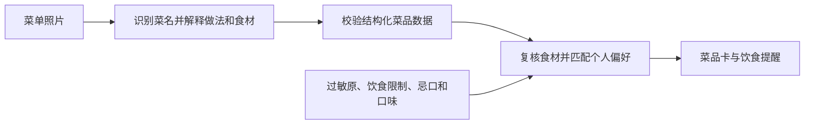
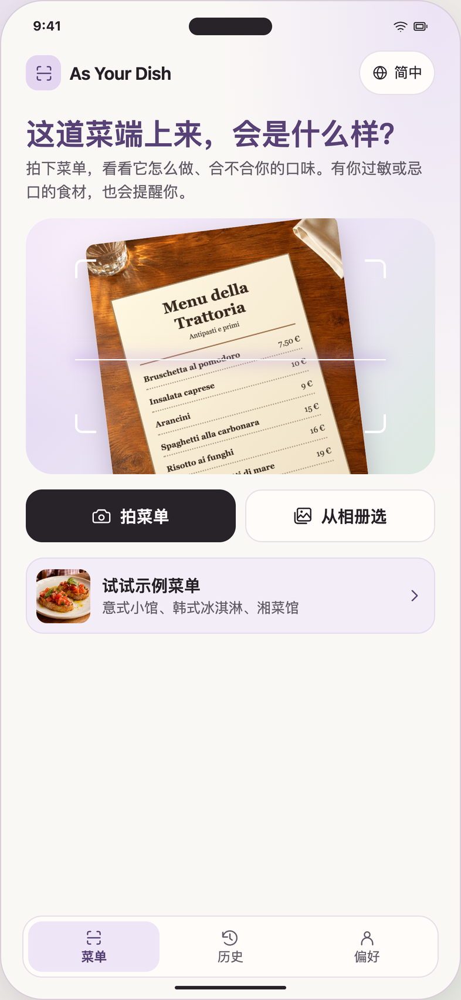
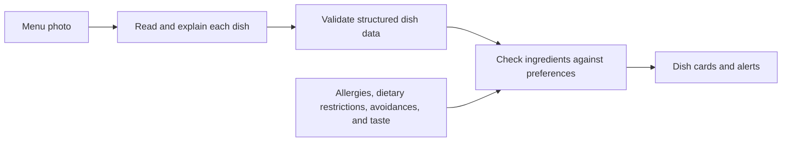

# As Your Dish

[中文](#中文) · [English](#english) · [交互原型 / Interactive prototype](./docs/prototype/index.html)

## 中文

As Your Dish 是一款面向跨语言点餐的菜单解析工具。它把菜单照片整理为逐道菜的说明，并根据用户设置给出饮食提醒。

### 背景与问题

在异国餐厅，读完菜名还想知道端上来的是什么，以及点餐前要确认什么。「蘑菇烩饭」这个名字告诉你主料，做法和配料则帮助你判断口味，并知道要不要问店员有没有放黄油或奶酪。

首版主要服务两类场景。旅行者需要在点餐前查清过敏或忌口线索。刚到海外的留学生和旅居者需要快速了解陌生菜品的做法和味道，再比较几道菜。

### 产品工作流

模型负责识别和解释菜品，应用按设定的顺序完成结构校验和饮食核对。用户可以用同一份菜单上的信息比较菜品，再结合自己的要求做决定。



1. **解释菜品。** 从照片提取菜名，保留原文，补充译名、做法、主要食材和六维口味。应用校验菜品信息，再用于逐道展示。
2. **核对饮食要求。** 后端根据食材补查可能的过敏原，再与当前档案核对。过敏原与饮食限制用红色提示，忌口与口味超限用黄色提示。
3. **呈现点餐依据。** 菜品卡同时展示原文、口味图和提示。用户能看见需要核实的食材，也能拿着原菜名向店员确认。同一份菜单可以重新打开，提醒按当前设置计算。

### 当前交付与原型体验

本期交付包括可分析菜单照片的网页应用，以及用内置示例演示同一流程的离线原型。网页应用支持拍摄或上传 1–5 张照片、保存饮食档案和回看历史，也可添加到手机主屏幕。

从 GitHub 下载 `index.html` 后用浏览器打开。选一个场景，模拟拍照并查看带参考图的菜品卡。右上角可以切换中文、English 或 한국어，界面和菜品译文会一起变化。

| 首页 | 拍摄场景 | 菜品详情 |
| --- | --- | --- |
|  |  |  |

[全部 12 张原型截图](./docs/prototype/screens) · [饮食偏好](./docs/prototype/screens/11-food-preferences.png)

有过敏顾虑时，请向餐厅确认食材和交叉接触情况。

### 产品文档

- **产品需求文档**记录首版范围、工作流、关键取舍和验收口径。[查看 PRD](./docs/product/prd.md)
- **目标用户与竞品分析**记录已完成的 20 人访谈、点餐旅程、同类产品对比及待验证问题。[查看研究与竞品分析](./docs/product/research-and-competitive-analysis.md)

### 本地运行

运行 React 和 Express 应用需要 Node.js 22+ 和 npm 10+。克隆仓库后，在项目根目录执行以下命令。

```bash
npm install
cp .env.example .env
npm run db:migrate -w backend
npx tsx backend/src/data/seedFromFixture.ts
npm run dev
```

浏览器打开 <http://localhost:5173>。后端默认监听 `3000`。示例菜单直接读取仓库里的预分析数据，无需模型密钥。

要分析自己的照片，在 `.env` 中为界面所选的视觉服务商填写对应的 API key，也可以按界面提示使用自己的 key。登录和注册需要 `JWT_SECRET`，可用 `openssl rand -hex 32` 生成。[完整环境变量](./.env.example)

常用检查命令为 `npm run typecheck`、`npm test` 和 `npm run build`。

### 代码从哪里看

| 目录 | 内容 |
| --- | --- |
| [`frontend/`](./frontend) | React、Vite、TypeScript 和 Tailwind 构成的移动网页。Recharts 绘制口味图，PWA 支持添加到主屏幕。 |
| [`backend/`](./backend) | Express API，通过 Drizzle 和 SQLite/libSQL 保存账号、饮食档案、历史、缓存和调用记录。 |
| [`shared/`](./shared) | 两端共用的 Zod 数据结构、语言和模型选项。 |

照片上传后，后端根据图片哈希、输出语言、服务商和模型查找缓存。需要新分析时，多服务商适配层会将结果转成共享的菜品结构。后端还会检查食材里的过敏原线索，再和用户档案核对。当前 DeepSeek 适配器在应用里标为纯文本，菜单照片请选择支持图片输入的服务商。[分析入口](./backend/src/routes/analyzeMenu.ts) · [模型选项](./shared/src/llm.ts) · [菜单 Prompt](./backend/src/prompts/analyze-menu.v2.md)

部署配置面向 Vercel 前端和 Fly.io API，数据库可通过 Fly.io 卷持久化。服务端额度、匿名限额和调用记账用于控制模型支出，缓存命中可省去一次模型请求。[前端配置](./vercel.json) · [后端配置](./backend/fly.toml)

### 下一步验证

- 对比模型在普通菜单、长菜单和非菜单照片上的表现，记录菜品漏识别、字段缺失和等待时间。
- 观察用户能否用卡片上的原名和食材线索向店员确认，再验证分享结果和按偏好推荐菜品的价值。
- 根据使用场景继续探索更多语言、本地化饮食标签，以及按餐厅和地区整理的菜单示例。

## English

As Your Dish helps people order from menus in unfamiliar languages. It turns a menu photo into dish explanations and dietary alerts based on the reader’s settings.

### Problem and audience

At the table, a translated name often leaves two questions open. What will arrive, and what should I check before ordering? “Mushroom risotto” tells you the main ingredient. The preparation and other ingredients help you judge the flavor and decide what to ask about if you avoid dairy.

The first version focuses on travelers who need to check for allergens or ingredients they avoid, and students and other people who have recently moved abroad and want to compare unfamiliar dishes.

### Product workflow

The model reads and explains the menu. The app validates the result and applies dietary checks in a defined sequence, so diners can compare the dishes using the same fields.



1. **Explain each dish.** Keep the printed name, translate it, and add preparation notes, key ingredients, and six flavor scores. The app validates those fields before presenting the cards.
2. **Check dietary requirements.** The server reviews ingredients for possible allergens and uses the current profile. Red alerts flag possible allergen or dietary conflicts. Yellow notes flag avoidances or flavors above the user’s limits.
3. **Show what to check before ordering.** Each card brings together the original name, flavor chart, and alerts. Diners can point to the name or ask about a particular ingredient. Reopening a menu uses the current settings for alerts.

### Current scope and prototype

The web app analyzes 1–5 menu photos at a time, supports saved dietary profiles and menu history, and can be added to a phone’s home screen. The offline prototype walks through the same workflow with bundled examples.

Download `index.html` from GitHub and open it in a browser. Pick a scene, simulate taking a menu photo, and explore the illustrated dish cards. The language control in the top right switches both the interface and the dish descriptions between Chinese, English, and Korean.

For allergy concerns, check ingredients and cross-contact with the restaurant.

[All 12 prototype screens](./docs/prototype/screens) · [Food preferences](./docs/prototype/screens/11-food-preferences.png)

### Product documentation

- **Product requirements** covers the initial scope, workflow, design decisions, and acceptance criteria. [Read the PRD in Chinese](./docs/product/prd.md)
- **User research and competitive analysis** records 20 completed interviews, the ordering journey, comparable products, and questions for further testing. [Read the analysis in Chinese](./docs/product/research-and-competitive-analysis.md)

### Run it locally

To run the React and Express app, clone the repository and use Node.js 22+ and npm 10+ from the project root.

```bash
npm install
cp .env.example .env
npm run db:migrate -w backend
npx tsx backend/src/data/seedFromFixture.ts
npm run dev
```

Open <http://localhost:5173>. The API defaults to port `3000`. You can browse the included sample menus without an API key.

To analyze your own photos, add an API key in `.env` for the vision provider selected in the app, or use the app’s own-key prompt. Registration and sign-in require `JWT_SECRET`. Generate one with `openssl rand -hex 32`. [Environment variables](./.env.example)

Run `npm run typecheck`, `npm test`, or `npm run build` to check the project locally.

### Where to look in the code

| Directory | What to look for |
| --- | --- |
| [`frontend/`](./frontend) | The React and Vite web app, with TypeScript, Tailwind, and Recharts. |
| [`backend/`](./backend) | The Express API. Drizzle and SQLite/libSQL store accounts, profiles, history, cached results, and model usage. |
| [`shared/`](./shared) | Zod schemas, language settings, and model options used by both sides. |

The API looks for cached results using the image hashes, output language, provider, and model. On a cache miss, the selected provider returns data in the shared dish schema. The server also checks ingredient text for allergen clues and compares the result with the user’s saved profile. The DeepSeek adapter is marked text-only in this app. Use a provider with image input for menu photos. [Analysis route](./backend/src/routes/analyzeMenu.ts) · [Model options](./shared/src/llm.ts) · [Menu prompt](./backend/src/prompts/analyze-menu.v2.md)

The deployment configuration targets Vercel for the frontend and Fly.io for the API and persistent SQLite database. Usage accounting and limits on server-key calls help manage model costs. [Frontend configuration](./vercel.json) · [Backend configuration](./backend/fly.toml)

### What to validate next

- Compare how providers handle ordinary menus, long menus, and photos that aren’t menus. Track missed dishes, incomplete fields, and wait times.
- Observe whether diners can use the original dish name and ingredient clues to check with staff. Then test the value of sharing results and suggesting dishes based on preferences.
- Use those findings to guide more languages, localized dietary labels, and menu examples organized by restaurant and region.
