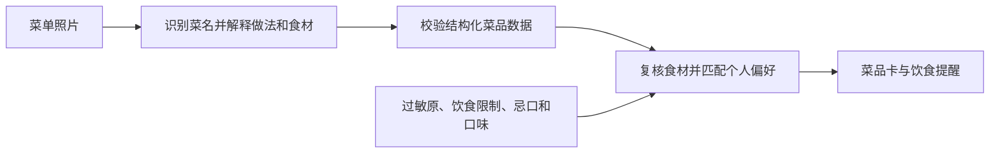
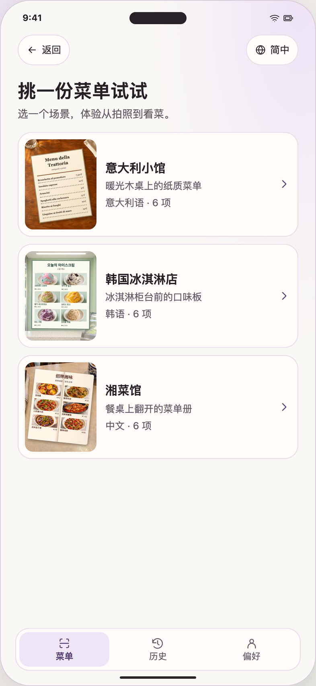
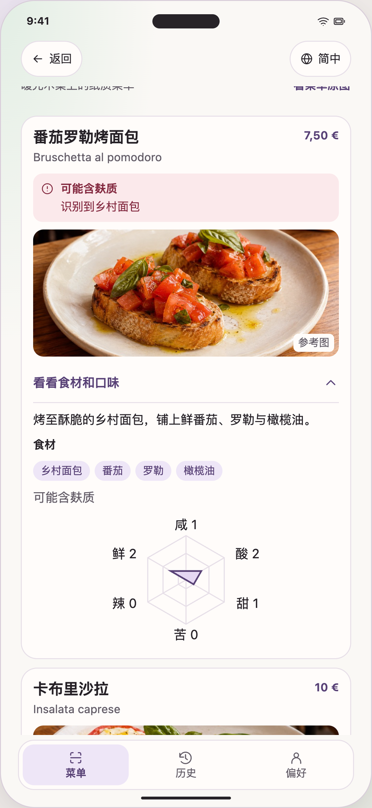
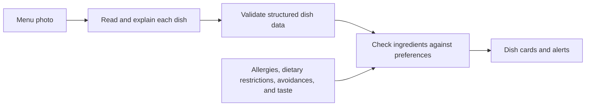

# As Your Dish

[中文](#中文) · [English](#english) · [交互原型 / Interactive prototype](./docs/prototype/index.html)

## 中文

在异国餐厅遇到陌生的菜名，想知道端上来会是什么样？拍下菜单，As Your Dish 会保留菜名原文，并介绍每道菜的做法、食材和可能的味道。登录后，还可以根据自己的口味、忌口和过敏设置查看提醒。

### 产品工作流

这套工作流先回答「这是什么菜」，再回答「点这道菜前，我需要留意什么」。模型负责识别和解释，应用按设定的顺序完成数据校验和饮食核对。



1. **看懂菜品。** 视觉模型从菜单照片提取菜名，保留原文，给出目标语言的译名、做法、主要食材和可能的口味。应用把每道菜整理成前后端共用的结构。
2. **对照自己的饮食要求。** 后端根据食材补查可能的过敏原，再与当前档案核对。同一份菜单的菜品数据可以复用，提醒会按当前设置计算。
3. **让用户自己决定点什么。** 菜品卡把原文、口味图和提醒放在一起。用户可以比较菜品，也可以带着具体菜名和食材线索向店员确认。

### 试试交互原型

从 GitHub 下载 `index.html` 后用浏览器打开。选一个场景，模拟拍照并查看六张带参考图的菜品卡。右上角可以切换中文、English 或 한국어，界面和菜品译文会一起变化。离线原型使用内置示例，让你走完这套流程。

| 首页 | 拍摄场景 | 菜品详情 |
| --- | --- | --- |
|  |  |  |

[全部 12 张原型截图](./docs/prototype/screens) · [饮食偏好](./docs/prototype/screens/11-food-preferences.png)

- 菜品卡保留原文和译名，还会显示介绍、食材与六维口味图。需要向店员确认时，可以直接指给对方看原文。
- 过敏原和饮食限制用红色提示，个人忌口和口味超限用黄色提示。运行应用后，登录也可保存设置和回看历史菜单。
- 应用支持拍摄或上传 1–5 张照片，也可添加到手机主屏幕。照片在上传前会先压缩，重复提交时会尝试复用已有结果。

有过敏顾虑时，请向餐厅确认食材和交叉接触情况。菜品提示来自对菜单照片的分析。

### 本地运行

运行 React 和 Express 应用需要 Node.js 22+ 和 npm 10+。克隆仓库后，在项目根目录执行以下命令。

```bash
npm install
cp .env.example .env
npm run db:migrate -w backend
npx tsx backend/src/data/seedFromFixture.ts
npm run dev
```

浏览器打开 <http://localhost:5173>。后端默认监听 `3000`。示例菜单直接读取仓库里的预分析数据，无需模型密钥。

要分析自己的照片，在 `.env` 中为界面所选的视觉服务商填写对应的 API key，也可以按界面提示使用自己的 key。登录和注册需要 `JWT_SECRET`，可用 `openssl rand -hex 32` 生成。[完整环境变量](./.env.example)

常用检查命令为 `npm run typecheck`、`npm test` 和 `npm run build`。

### 代码从哪里看

| 目录 | 内容 |
| --- | --- |
| [`frontend/`](./frontend) | React、Vite、TypeScript 和 Tailwind 构成的移动网页。Recharts 绘制口味图，PWA 支持添加到主屏幕。 |
| [`backend/`](./backend) | Express API，通过 Drizzle 和 SQLite/libSQL 保存账号、饮食档案、历史、缓存和调用记录。 |
| [`shared/`](./shared) | 两端共用的 Zod 数据结构、语言和模型选项。 |

照片上传后，后端根据图片哈希、输出语言、服务商和模型查找缓存。需要新分析时，多服务商适配层会将结果转成共享的菜品结构。后端还会检查食材里的过敏原线索，再和用户档案核对。当前 DeepSeek 适配器在应用里标为纯文本，菜单照片请选择支持图片输入的服务商。[分析入口](./backend/src/routes/analyzeMenu.ts) · [模型选项](./shared/src/llm.ts) · [菜单 Prompt](./backend/src/prompts/analyze-menu.v2.md)

部署配置面向 Vercel 前端和 Fly.io API，数据库可通过 Fly.io 卷持久化。服务端额度、匿名限额和调用记账用于控制模型支出，缓存命中可省去一次模型请求。[前端配置](./vercel.json) · [后端配置](./backend/fly.toml)

### 接下来想做

- 增加不同模型的对比测试，重点看长菜单和误传的非菜单照片。
- 支持分享菜单结果，补充演示素材。
- 继续探索按偏好推荐菜品、更多输出语言和本地化饮食标签，以及按餐厅和地区积累菜单示例。

## English

What will that dish actually be like when it arrives? Take a photo of the menu to see the original dish names, how each dish is usually prepared, what goes into it, and what it might taste like. Sign in to see what to watch for based on your tastes, food avoidances, and allergies.

### Product workflow

The workflow answers two questions you might ask at the table. What is this dish, and what should I check before ordering it? The model reads and explains the menu. The app follows a defined sequence to validate the result and apply the dietary checks.



1. **Understand the dish.** A vision model reads the menu, keeps the original names, and explains the preparation, key ingredients, and likely flavors in the selected language. The app validates the result against a shared dish schema.
2. **Check what matters to you.** The server reviews ingredient clues for possible allergens and checks the dishes against your current profile. The same menu analysis can be reused, with alerts calculated from each reader’s settings.
3. **Decide what to order.** Each card brings the original name, a flavor chart, and any alerts together. You can compare dishes or ask restaurant staff about a specific dish or ingredient.

### Try the prototype

Download `index.html` from GitHub and open it in a browser. Pick a scene, try taking a menu photo, and explore six illustrated dish cards. The language control in the top-right switches both the interface and dish descriptions between Chinese, English, and Korean. The offline prototype walks through the workflow with bundled examples.

- **Read a dish card.** See the original name alongside the translation, preparation notes, ingredients, and a six-axis flavor chart. Keep the original name handy when talking to restaurant staff.
- **Set your food preferences.** Red alerts flag possible conflicts with allergens or dietary restrictions. Yellow notes flag ingredients you avoid or flavors above your limits. When running the app, sign in to save your settings and revisit your history.
- **Use it on your phone.** The app supports taking or uploading 1–5 photos and can be added to your home screen. It compresses photos before upload and looks for a cached result when you submit the same images again.

For allergy concerns, check ingredients and cross-contact with the restaurant. Dish flags are based on analysis of the photographed menu.

[All 12 prototype screens](./docs/prototype/screens) · [Food preferences](./docs/prototype/screens/11-food-preferences.png)

### Run it locally

To run the React and Express app, clone the repository and use Node.js 22+ and npm 10+ from the project root.

```bash
npm install
cp .env.example .env
npm run db:migrate -w backend
npx tsx backend/src/data/seedFromFixture.ts
npm run dev
```

Open <http://localhost:5173>. The API defaults to port `3000`. You can browse the included sample menus without an API key.

To analyze your own photos, add an API key in `.env` for the vision provider selected in the app, or use the app’s own-key prompt. Registration and sign-in require `JWT_SECRET`. Generate one with `openssl rand -hex 32`. [Environment variables](./.env.example)

Run `npm run typecheck`, `npm test`, or `npm run build` to check the project locally.

### Where to look in the code

| Directory | What to look for |
| --- | --- |
| [`frontend/`](./frontend) | The React and Vite web app, with TypeScript, Tailwind, and Recharts. |
| [`backend/`](./backend) | The Express API. Drizzle and SQLite/libSQL store accounts, profiles, history, cached results, and model usage. |
| [`shared/`](./shared) | Zod schemas, language settings, and model options used by both sides. |

The API looks for cached results using the image hashes, output language, provider, and model. On a cache miss, the selected provider returns data in the shared dish schema. The server also checks ingredient text for allergen clues and compares the result with the user’s saved profile. The DeepSeek adapter is marked text-only in this app. Use a provider with image input for menu photos. [Analysis route](./backend/src/routes/analyzeMenu.ts) · [Model options](./shared/src/llm.ts) · [Menu prompt](./backend/src/prompts/analyze-menu.v2.md)

The deployment configuration targets Vercel for the frontend and Fly.io for the API and persistent SQLite database. Usage accounting and limits on server-key calls help manage model costs. [Frontend configuration](./vercel.json) · [Backend configuration](./backend/fly.toml)

### What’s next

- Test providers against longer menus and photos that aren’t menus.
- Make analysis results shareable and expand the demo materials.
- Explore dishes suggested by preference, more languages and localized dietary labels, and menu examples organized by restaurant and region.
