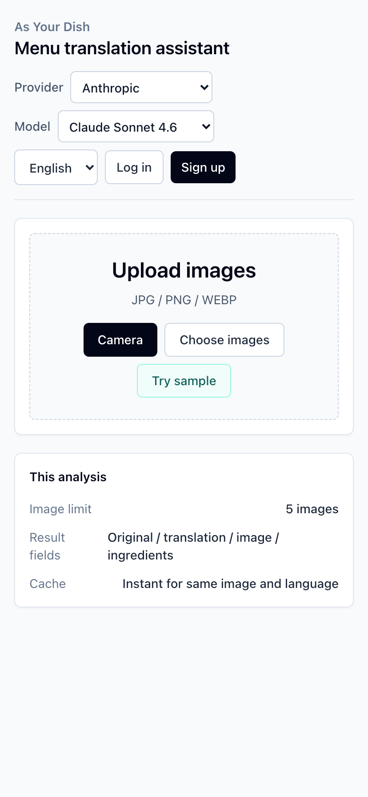
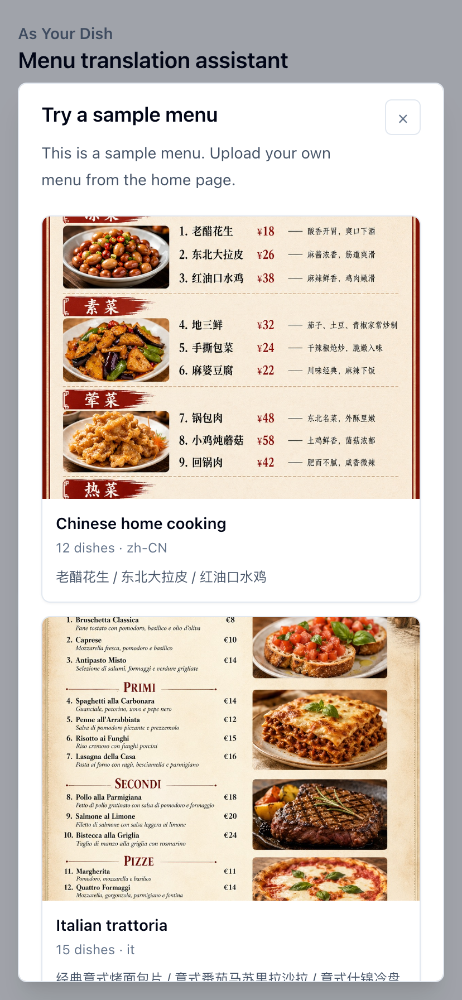
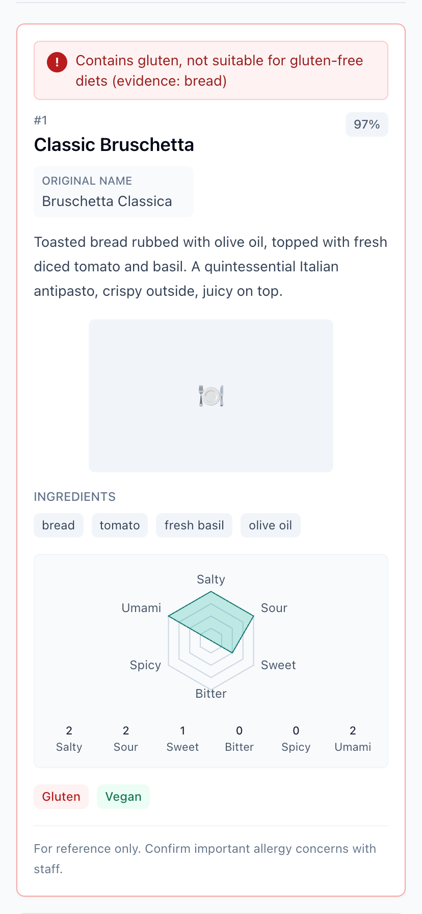
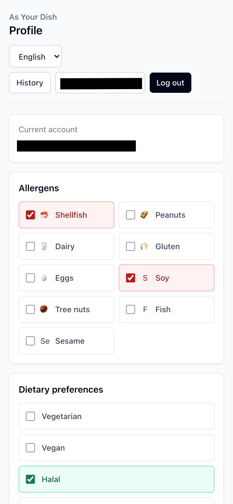
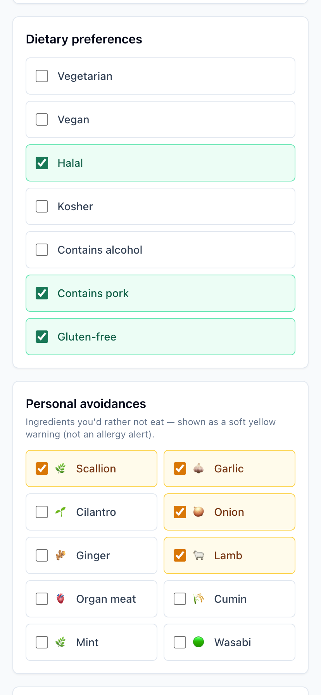
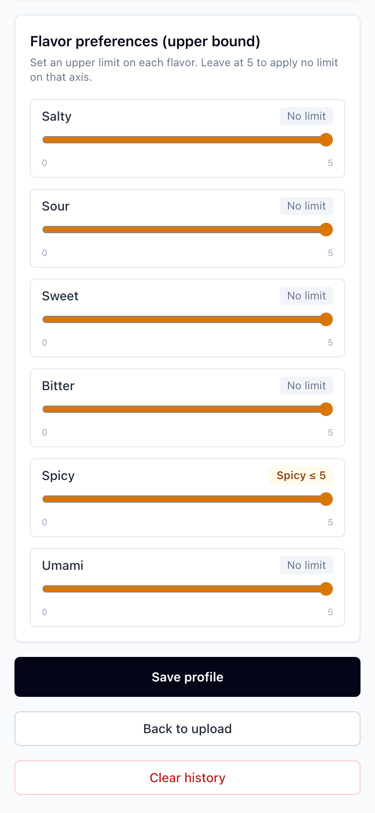
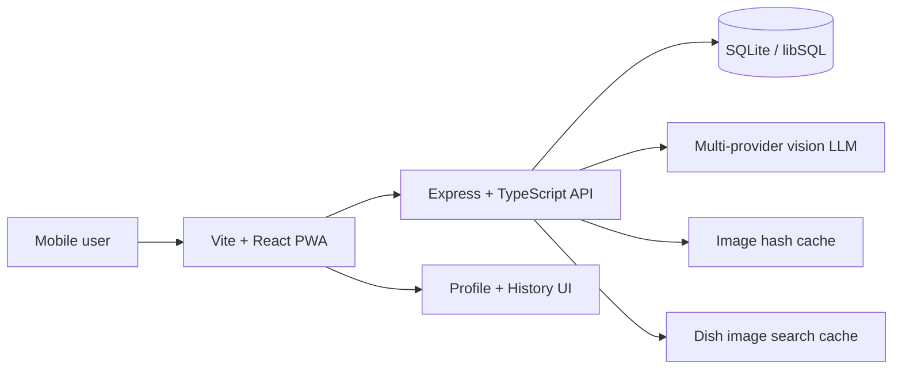

# As Your Dish

**🌐 Language / 语言:** [🇨🇳 中文](#中文) · [🇺🇸 English](#english)

**Live Demo:** [as-your-dish.vercel.app](https://as-your-dish.vercel.app)

---

<a id="中文"></a>

## 中文

> [Switch to English ↓](#english)

> 拍照即懂菜单的 AI 菜单助手：面向境外旅行、工作、留学人群，把外文菜单转化为可直接下单决策的菜品卡片，并在过敏原与饮食偏好冲突时提前提醒。

### 🌟 项目定位与核心价值

**As Your Dish 是一款移动优先的 AI 菜单理解 PWA。**

它解决的核心痛点是：用户在国外餐厅面对陌生语言菜单时，通常不知道菜品是什么、口味如何、是否含有过敏原或不符合个人饮食习惯。As Your Dish 通过“拍照 → 识别 → 意译 → 风险提示”的路径，把菜单从“看不懂的文本”变成“可判断、可比较、可下单”的结构化信息。

目标用户：

- 境外旅行、出差、留学的中文母语者
- 有过敏原、忌口、素食、宗教饮食等限制的用户
- 想快速理解异国料理背景和口味的人

核心价值：

- **降低点餐不确定性**：不只翻译菜名，而是解释做法、食材、口味和文化背景。
- **提前暴露饮食风险**：结合用户档案，对过敏原和饮食偏好冲突做醒目提醒。
- **适配真实使用场景**：手机拍照、图片压缩、PWA、示例菜单和历史记录，服务餐厅现场的弱网使用。

> 健康提醒：识别结果仅供辅助决策。严重过敏或医疗相关饮食限制，请务必向餐厅工作人员二次确认。

### 📸 截图速览

| 首页入口 | 试用示例菜单 | 菜品卡片 |
|---|---|---|
|  |  |  |
| 选 LLM 服务商和模型、切换输出语言；拍照 / 选图 / 试用示例 | 内置三份预分析菜单（中 / 意 / 日），零 LLM 调用即可体验完整流程 | 过敏原红条 + 6 维口味雷达图 + 食材标签 + 置信度 |

| 过敏原档案 | 饮食偏好 + 个人忌口 | 口味上限 |
|---|---|---|
|  |  |  |
| FDA-9 过敏原勾选，命中即红条警示 | Halal / 含猪肉 / 无麸质等饮食偏好；个人忌口走黄条软提示（非过敏，仅"不想吃"） | 每条口味轴可设上限，超过则在菜品卡片上提醒 |

### 🚀 核心功能与用户路径

#### 用户路径

| 阶段 | 用户动作 | 产品反馈 | 用户获得的价值 |
|---|---|---|---|
| 1. 进入首页 | 打开 PWA，选择输出语言和 LLM 服务商 | 显示拍照上传入口、示例菜单入口 | 无需学习成本，直接开始 |
| 2. 提交菜单 | 拍照、上传图片，或打开内置示例菜单 | 前端压缩图片并提交分析 | 弱网环境下减少等待和失败 |
| 3. 理解菜品 | 查看菜名意译、描述、食材、口味雷达图 | 每道菜形成独立卡片 | 从“翻译文本”升级为“点餐决策” |
| 4. 规避风险 | 登录后设置过敏原、饮食偏好、忌口 | 冲突菜品显示红色警示 | 重要风险前置，不靠用户逐项排查 |
| 5. 复用结果 | 查看历史菜单或重复上传同图 | 缓存命中后快速返回 | 降低重复等待和 LLM 成本 |

#### 核心功能

| 功能 | 用户视角 | 差异化优势 |
|---|---|---|
| 菜单图片识别 | 上传 1–5 张菜单照片 | 一次返回整份菜单，不要求用户逐道输入 |
| 菜名意译与背景解释 | 看到目标语言菜名、做法、文化背景 | 避免直译误导，帮助理解真实菜品 |
| 食材与过敏原标记 | 每道菜列出主要食材和 FDA-9 过敏原 | LLM 判断后再做服务端关键词兜底 |
| 饮食偏好匹配 | 识别素食、含猪肉、含酒精、麸质等限制 | 结合用户档案做个性化提醒 |
| 6 维口味雷达图 | 直观看到咸、酸、甜、苦、辣、鲜 | 帮用户快速判断是否合口味 |
| 示例菜单 | 不上传个人图片也能体验完整流程 | 首次体验不消耗 LLM 调用 |
| 历史记录 | 找回过去分析过的菜单 | 适合旅行中多次回看 |
| 自带 API Key | 服务端额度耗尽时可继续使用 | 降低公开 Demo 的运营中断风险 |

### 🛠️ 技术选型与架构



| 层 | 技术选型 | 产品侧理由 |
|---|---|---|
| 前端 | Vite + React + TypeScript | 启动快、交互轻，适合移动端 PWA 和快速迭代 |
| 样式 | Tailwind CSS | 保持界面一致性，快速适配小屏幕 |
| 状态管理 | React Query + Zustand | 服务端数据、登录态、用户档案职责清晰 |
| 表单与校验 | react-hook-form + Zod | 用户档案输入可复用同一套类型约束 |
| 图表 | Recharts | 用较低成本实现口味雷达图 |
| 后端 | Node.js + Express + TypeScript | 与前端共享语言和类型，降低维护成本 |
| 数据层 | Drizzle ORM + SQLite/libSQL | 轻量、可迁移，适合低成本个人 Demo 和早期产品 |
| LLM 层 | Anthropic / OpenAI / Gemini / Qwen / Kimi / GLM / Doubao / DeepSeek 适配 | 通过统一 provider 接口控制成本、可用性和模型替换风险 |
| 结构化输出 | Zod schema + provider adapter | 保证菜品卡片字段稳定，减少前端解析失败 |
| 成本控制 | 图片 hash 缓存、客户端压缩、额度限制、自带 Key | 控制公开 Demo 的带宽、延迟和模型调用费用 |
| 部署 | Vercel 前端 + Fly.io 后端 | 前端分发快，后端保留真实 Node 服务和持久化能力 |

架构原则：

- **移动优先**：拍照入口、图片压缩、PWA 和小屏布局服务真实餐厅场景。
- **结构化优先**：所有菜品都落到统一 `Dish` schema，前后端共享类型。
- **风险优先**：过敏原提示采用“宁可多提醒，不漏提醒”的策略。
- **成本可控**：重复图片走缓存，示例菜单走静态 fixture，用户可填自己的 provider key。

### 📦 快速上手

环境要求：

- Node.js 22+
- npm 10+

```bash
git clone https://github.com/txxh-z/as-your-dish.git
cd as-your-dish
npm install
cp .env.example .env
```

配置 `.env`：

```bash
# 选择一个服务商，并填写对应 key
LLM_PROVIDER=anthropic
ANTHROPIC_API_KEY=
# DEEPSEEK_API_KEY=

# 生成本地登录密钥
JWT_SECRET=
```

初始化本地数据库和示例菜单：

```bash
npm run db:migrate -w backend
npx tsx backend/src/data/seedFromFixture.ts
```

启动开发环境：

```bash
npm run dev
```

打开 `http://localhost:5173`。

常用命令：

```bash
npm run typecheck
npm run build
npm run test
```

首次体验建议先使用首页的“试用示例菜单”，无需消耗 LLM 调用；分析自己的菜单图片时需要配置服务端 API key，或在页面中填入个人 provider key。

### 🗺️ 产品路线图

#### 已完成

- 菜单图片上传、压缩和端到端 AI 分析
- 菜品卡片：原文菜名、目标语言意译、描述、食材、口味雷达图
- 过敏原和饮食偏好档案
- 登录、历史记录、示例菜单
- 多语言输出：中文、English、한국어
- 多 LLM provider 适配与自带 API key
- 图片 hash 缓存、月度额度、Demo 限流
- Vercel + Fly.io 部署路径

#### 近期计划

- 强化非菜单图片识别，减少弱视觉模型的幻觉输出
- 为不同 provider 增加稳定性基准测试：正常菜单、长菜单、非菜单图片
- 完善 Demo/GIF、产品截图和公开展示素材
- 增加菜单分析结果的分享链接

#### 长期愿景

- 从“看懂菜单”扩展到“帮我选择”：基于用户偏好推荐 Top dishes
- 支持更多输出语言和本地化饮食标签
- 增加餐厅级菜单集合、旅行目的地常见菜系知识库
- 引入更细粒度的健康风险解释，但保持结果辅助性质，不替代人工确认

---

<a id="english"></a>

## English

> [切换到中文 ↑](#中文)

> An AI menu assistant you point your camera at: built for travelers, expats, and overseas students, it turns foreign-language menus into orderable dish cards and flags allergen or dietary-preference conflicts before you order.

### 🌟 Value Proposition

**As Your Dish is a mobile-first AI menu-understanding PWA.**

The pain point: in a foreign restaurant, you usually can't tell what a dish is, how it tastes, whether it contains an allergen, or whether it conflicts with your dietary preferences. As Your Dish follows the path of *photograph → recognize → translate idiomatically → flag risks*, turning a menu from “text I can't read” into structured information you can judge, compare, and order from.

Target users:

- Native Chinese speakers traveling, working, or studying abroad
- Anyone with allergens, food avoidances, vegetarian, or religious dietary restrictions
- People who want to quickly understand the background and flavor of unfamiliar cuisine

Core value:

- **Reduce ordering uncertainty** — not just translate the name, but explain the preparation, ingredients, flavor, and cultural context.
- **Surface dietary risks early** — cross-check against the user's profile and flag allergen/dietary conflicts prominently.
- **Fit real-world use** — phone camera, client-side compression, PWA, sample menus, and history are tuned for restaurant-floor use over flaky networks.

> Health notice: recognition results are advisory only. For severe allergies or medical dietary restrictions, please confirm directly with restaurant staff.

### 📸 Screenshots

| Home | Sample menu picker | Dish card |
|---|---|---|
|  |  |  |
| Pick LLM provider and model, switch output language; camera / upload / try a sample | Three pre-analyzed sample menus (Chinese / Italian / Japanese) — full flow at zero LLM cost | Allergen red bar + 6-axis flavor radar + ingredient tags + confidence |

| Allergens profile | Dietary preferences + personal avoidances | Flavor upper bounds |
|---|---|---|
|  |  |  |
| Check FDA-9 allergens — hits get a red warning on each dish | Dietary preferences like Halal / contains pork / gluten-free; personal avoidances surface as a softer yellow note (not allergic, just "don't want") | Set a per-axis upper bound — dishes exceeding it get a warning |

### 🚀 Key Features & User Journey

#### User journey

| Stage | User action | Product response | Value to the user |
|---|---|---|---|
| 1. Land on home | Open PWA, pick output language and LLM provider | Upload entry point and sample-menu entry shown | Zero learning curve |
| 2. Submit a menu | Take a photo, upload, or open a built-in sample | Frontend compresses the image and submits for analysis | Less waiting and fewer failures on weak networks |
| 3. Understand dishes | Read translated name, description, ingredients, flavor radar | Each dish becomes its own card | Upgraded from “translation” to “ordering decision” |
| 4. Avoid risks | After login, set allergens, dietary preferences, avoidances | Conflicting dishes get a red warning | Important risks are front-loaded — no manual scanning |
| 5. Reuse results | Open the history page or re-upload the same image | Cache hits return instantly | Avoid repeated waits and LLM cost |

#### Core features

| Feature | User-facing | Differentiator |
|---|---|---|
| Menu image recognition | Upload 1–5 menu photos | Returns the whole menu at once — no per-dish input |
| Idiomatic translation & cultural notes | Translated name, preparation, cultural background | Avoids misleading literal translations |
| Ingredient & allergen tagging | Each dish lists main ingredients and FDA-9 allergens | LLM tagging plus server-side keyword fallback |
| Dietary-preference matching | Detects vegetarian, contains pork / alcohol / gluten, etc. | Personalized based on user profile |
| 6-axis flavor radar | Salty, sour, sweet, bitter, spicy, umami at a glance | Quick fit-to-taste judgment |
| Sample menus | Try the full flow without uploading anything | First experience costs zero LLM calls |
| History | Revisit menus analyzed earlier | Useful for re-reference while traveling |
| Bring-your-own API key | Keep using the app when the server quota runs out | Reduces downtime risk for the public demo |

### 🛠️ Tech Stack & Architecture


| Layer | Choice | Product-side rationale |
|---|---|---|
| Frontend | Vite + React + TypeScript | Fast startup, light interactions, fits a mobile PWA and rapid iteration |
| Styling | Tailwind CSS | Consistent UI, fast to adapt to small screens |
| State | React Query + Zustand | Clear separation between server state, auth, and user profile |
| Forms & validation | react-hook-form + Zod | Profile inputs reuse the same type constraints |
| Charts | Recharts | Low-cost flavor radar implementation |
| Backend | Node.js + Express + TypeScript | Shares language and types with the frontend |
| Data | Drizzle ORM + SQLite/libSQL | Lightweight, portable; fits a low-cost personal demo and early product |
| LLM | Anthropic / OpenAI / Gemini / Qwen / Kimi / GLM / Doubao / DeepSeek adapters | Unified provider interface to control cost, availability, and switching risk |
| Structured output | Zod schema + provider adapter | Stable dish-card fields, fewer frontend parsing failures |
| Cost control | Image hash cache, client-side compression, quota limits, BYO key | Manages bandwidth, latency, and model spend on the public demo |
| Deployment | Vercel frontend + Fly.io backend | Fast frontend delivery; real Node + persistent storage on the backend |

Architectural principles:

- **Mobile-first** — camera entry, image compression, PWA, and small-screen layout serve the real restaurant scenario.
- **Structure-first** — every dish lands in a shared `Dish` schema; frontend and backend share types.
- **Risk-first** — allergen warnings follow “over-warn rather than under-warn”.
- **Cost-aware** — duplicate images hit the cache, sample menus use static fixtures, users can supply their own provider key.

### 📦 Quick Start

Requirements:

- Node.js 22+
- npm 10+

```bash
git clone https://github.com/txxh-z/as-your-dish.git
cd as-your-dish
npm install
cp .env.example .env
```

Configure `.env`:

```bash
# Pick one provider and fill in the corresponding key
LLM_PROVIDER=anthropic
ANTHROPIC_API_KEY=
# DEEPSEEK_API_KEY=

# Generate a local auth secret
JWT_SECRET=
```

Initialize the local database and sample menus:

```bash
npm run db:migrate -w backend
npx tsx backend/src/data/seedFromFixture.ts
```

Start the dev environment:

```bash
npm run dev
```

Open `http://localhost:5173`.

Common scripts:

```bash
npm run typecheck
npm run build
npm run test
```

For your first try, use the “sample menu” button on the home page — it costs no LLM calls. Analyzing your own menu photos requires a server-side API key in `.env`, or a user-supplied provider key entered in the UI.

### 🗺️ Roadmap

#### Shipped

- Menu image upload, compression, and end-to-end AI analysis
- Dish cards: original name, target-language translation, description, ingredients, flavor radar
- Allergen and dietary-preference profile
- Login, history, sample menus
- Multilingual output: 中文, English, 한국어
- Multi-LLM-provider adapters and bring-your-own API key
- Image hash caching, monthly quota, demo-mode rate limit
- Vercel + Fly.io deployment path

#### Near-term

- Better non-menu image rejection to reduce hallucinations from weaker vision models
- Stability benchmarks per provider: normal menus, long menus, non-menu images
- Polish demo / GIF, screenshots, and public-facing assets
- Shareable links for analyzed menus

#### Long-term

- Beyond “understand the menu” → “help me choose”: recommend top dishes based on user preferences
- More output languages and localized dietary labels
- Restaurant-level menu collections and regional-cuisine knowledge base for travel destinations
- More granular health-risk explanations, while keeping the output advisory — never a replacement for human confirmation
