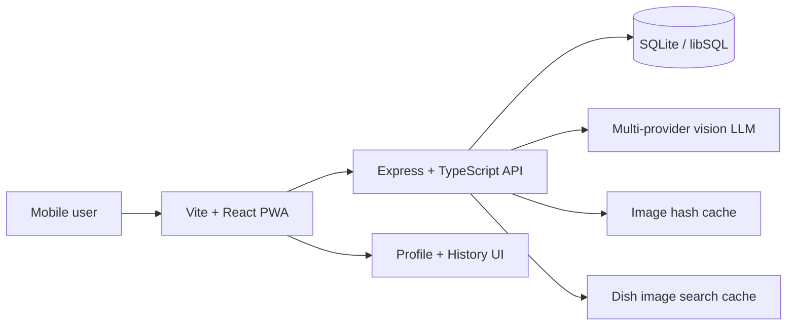

# As Your Dish

> 拍照即懂菜单的 AI 菜单助手：面向境外旅行、工作、留学人群，把外文菜单转化为可直接下单决策的菜品卡片，并在过敏原与饮食偏好冲突时提前提醒。

**Live Demo:** [as-your-dish.vercel.app](https://as-your-dish.vercel.app)

---

## 🌟 项目定位与核心价值 (Value Proposition)

**As Your Dish 是一款移动优先的 AI 菜单理解 PWA。**

它解决的核心痛点是：用户在国外餐厅面对陌生语言菜单时，通常不知道菜品是什么、口味如何、是否含有过敏原或不符合个人饮食习惯。As Your Dish 通过“拍照 → 识别 → 意译 → 风险提示”的路径，把菜单从“看不懂的文本”变成“可判断、可比较、可下单”的结构化信息。

目标用户：

- 境外旅行、出差、留学的中文母语者
- 有过敏原、忌口、素食、宗教饮食等限制的用户
- 想快速理解异国料理背景和口味的人

核心价值：

- **降低点餐不确定性**：不只翻译菜名，而是解释做法、食材、口味和文化背景。
- **提前暴露饮食风险**：结合用户档案，对过敏原和饮食偏好冲突做醒目提醒。
- **适配真实使用场景**：手机拍照、图片压缩、PWA、示例菜单和历史记录，服务餐厅现场的弱网使用。

> 健康提醒：识别结果仅供辅助决策。严重过敏或医疗相关饮食限制，请务必向餐厅工作人员二次确认。

---

## 🚀 核心功能与用户路径 (Key Features & User Journey)

### Demo / GIF 占位

> 建议放置 `docs/screenshots/demo.gif`：展示“打开首页 → 拍照/选择示例菜单 → 查看菜品卡片 → 触发过敏提醒”的完整路径。

### 用户路径

| 阶段 | 用户动作 | 产品反馈 | 用户获得的价值 |
|---|---|---|---|
| 1. 进入首页 | 打开 PWA，选择输出语言和 LLM 服务商 | 显示拍照上传入口、示例菜单入口 | 无需学习成本，直接开始 |
| 2. 提交菜单 | 拍照、上传图片，或打开内置示例菜单 | 前端压缩图片并提交分析 | 弱网环境下减少等待和失败 |
| 3. 理解菜品 | 查看菜名意译、描述、食材、口味雷达图 | 每道菜形成独立卡片 | 从“翻译文本”升级为“点餐决策” |
| 4. 规避风险 | 登录后设置过敏原、饮食偏好、忌口 | 冲突菜品显示红色警示 | 重要风险前置，不靠用户逐项排查 |
| 5. 复用结果 | 查看历史菜单或重复上传同图 | 缓存命中后快速返回 | 降低重复等待和 LLM 成本 |

### 核心功能

| 功能 | 用户视角 | 差异化优势 |
|---|---|---|
| 菜单图片识别 | 上传 1–5 张菜单照片 | 一次返回整份菜单，不要求用户逐道输入 |
| 菜名意译与背景解释 | 看到目标语言菜名、做法、文化背景 | 避免直译误导，帮助理解真实菜品 |
| 食材与过敏原标记 | 每道菜列出主要食材和 FDA-9 过敏原 | LLM 判断后再做服务端关键词兜底 |
| 饮食偏好匹配 | 识别素食、含猪肉、含酒精、麸质等限制 | 结合用户档案做个性化提醒 |
| 6 维口味雷达图 | 直观看到咸、酸、甜、苦、辣、鲜 | 帮用户快速判断是否合口味 |
| 示例菜单 | 不上传个人图片也能体验完整流程 | 首次体验不消耗 LLM 调用 |
| 历史记录 | 找回过去分析过的菜单 | 适合旅行中多次回看 |
| 自带 API Key | 服务端额度耗尽时可继续使用 | 降低公开 Demo 的运营中断风险 |

---

## 🛠️ 技术选型与架构 (Tech Stack & Architecture)



| 层 | 技术选型 | 产品侧理由 |
|---|---|---|
| 前端 | Vite + React + TypeScript | 启动快、交互轻，适合移动端 PWA 和快速迭代 |
| 样式 | Tailwind CSS | 保持界面一致性，快速适配小屏幕 |
| 状态管理 | React Query + Zustand | 服务端数据、登录态、用户档案职责清晰 |
| 表单与校验 | react-hook-form + Zod | 用户档案输入可复用同一套类型约束 |
| 图表 | Recharts | 用较低成本实现口味雷达图 |
| 后端 | Node.js + Express + TypeScript | 与前端共享语言和类型，降低维护成本 |
| 数据层 | Drizzle ORM + SQLite/libSQL | 轻量、可迁移，适合低成本个人 Demo 和早期产品 |
| LLM 层 | Anthropic / OpenAI / Gemini / Qwen / Kimi / GLM / Doubao 适配 | 通过统一 provider 接口控制成本、可用性和模型替换风险 |
| 结构化输出 | Zod schema + provider adapter | 保证菜品卡片字段稳定，减少前端解析失败 |
| 成本控制 | 图片 hash 缓存、客户端压缩、额度限制、自带 Key | 控制公开 Demo 的带宽、延迟和模型调用费用 |
| 部署 | Vercel 前端 + Fly.io 后端 | 前端分发快，后端保留真实 Node 服务和持久化能力 |

架构原则：

- **移动优先**：拍照入口、图片压缩、PWA 和小屏布局服务真实餐厅场景。
- **结构化优先**：所有菜品都落到统一 `Dish` schema，前后端共享类型。
- **风险优先**：过敏原提示采用“宁可多提醒，不漏提醒”的策略。
- **成本可控**：重复图片走缓存，示例菜单走静态 fixture，用户可填自己的 provider key。

---

## 📦 快速上手 (Onboarding Guide)

环境要求：

- Node.js 22+
- npm 10+

```bash
git clone https://github.com/txxh-z/as-your-dish.git
cd as-your-dish
npm install
cp .env.example .env
```

配置 `.env`：

```bash
# 选择一个服务商，并填写对应 key
LLM_PROVIDER=anthropic
ANTHROPIC_API_KEY=

# 生成本地登录密钥
JWT_SECRET=
```

初始化本地数据库和示例菜单：

```bash
npm run db:migrate -w backend
npx tsx backend/src/data/seedFromFixture.ts
```

启动开发环境：

```bash
npm run dev
```

打开 `http://localhost:5173`。

常用命令：

```bash
npm run typecheck
npm run build
npm run test
```

首次体验建议先使用首页的“试用示例菜单”，无需消耗 LLM 调用；分析自己的菜单图片时需要配置服务端 API key，或在页面中填入个人 provider key。

---

## 🗺️ 产品路线图 (Roadmap)

### 已完成

- 菜单图片上传、压缩和端到端 AI 分析
- 菜品卡片：原文菜名、目标语言意译、描述、食材、口味雷达图
- 过敏原和饮食偏好档案
- 登录、历史记录、示例菜单
- 多语言输出：中文、English、한국어
- 多 LLM provider 适配与自带 API key
- 图片 hash 缓存、月度额度、Demo 限流
- Vercel + Fly.io 部署路径

### 近期计划

- 强化非菜单图片识别，减少弱视觉模型的幻觉输出
- 为不同 provider 增加稳定性基准测试：正常菜单、长菜单、非菜单图片
- 完善 Demo/GIF、产品截图和公开展示素材
- 增加菜单分析结果的分享链接

### 长期愿景

- 从“看懂菜单”扩展到“帮我选择”：基于用户偏好推荐 Top dishes
- 支持更多输出语言和本地化饮食标签
- 增加餐厅级菜单集合、旅行目的地常见菜系知识库
- 引入更细粒度的健康风险解释，但保持结果辅助性质，不替代人工确认
