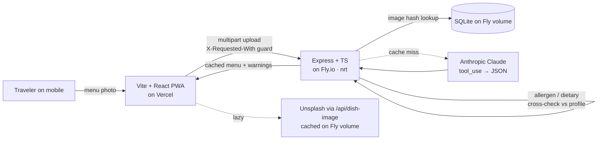

# As Your Dish

> 帮中文母语者在境外旅行/工作时看懂外文菜单的 PWA。拍一张菜单 → 每道菜识别、意译、配文化背景、拆食材、画 6 维口味雷达图，并**根据你预设的过敏原和饮食偏好红条高亮警示**。
>
> Decode foreign-language menus before you order. A mobile-first PWA built for travelers.
>
> **在线 Demo → [as-your-dish.vercel.app](https://as-your-dish.vercel.app)** · [English README](./README.md)


业余时间做的作品集项目，~10 个有效工作日独立完成。目标是把一个端到端的移动端 AI 产品工程能力展示清楚：tool-constrained LLM I/O、多供应商成本治理、健康数据场景下的安全 UX、以及在个人预算下运营一个真实的公网服务。

代码里所有非显然的设计决定都标了 `// WHY: ...`，git log 从第一个 commit 起严格走 Conventional Commits ——为的就是面试时翻给人看。

---

## Demo 速览

| 拍照 | 看菜单 | 风险提示 |
|---|---|---|
|  |  |  |

| 口味雷达图 | 个人档案 | 历史 |
|---|---|---|
|  |  |  |

不想上传自己的菜单的话，首页「试用示例」按钮可直接载入三份预先分析好的样例菜单（中 / 意 / 日），完全不调 LLM。

---

## 架构



- **前端**：React + Vite + TypeScript + Tailwind + PWA。移动端优先，按 iPhone SE（375 px）做过验收。
- **后端**：Node 22 + Express + TypeScript，跑在 Fly Fluid Compute 上。Multer 处理图片上传，Drizzle ORM + libsql/SQLite 存储，`express-rate-limit` 控成本，`helmet` 加响应头。
- **共享层**：`shared/` 工作区导出 Zod schema。`Dish` 类型有唯一源头，前后端 + Claude `tool_use` 的 input_schema 都从这里编译出来。
- **LLM**：供应商中立的 `LLMProvider` 接口，目前三个 adapter——Anthropic Claude（完整实现）、OpenAI GPT-4o（骨架 + 单价）、Google Gemini（骨架 + 单价）。`LLM_PROVIDER` env 切换。用户也可以填自己的 Anthropic key 绕过运营方的配额。

---

## 技术栈

| 层 | 选择 | 为什么 |
|---|---|---|
| 前端框架 | Vite + React + TypeScript | HMR 快、bundle 体积可控、类型一路通到 API 边界。 |
| 样式 | Tailwind CSS | 移动端优先的工具类；鼓励低 CSS 耦合的组件。 |
| 前端状态 | React Query + Zustand | 服务端状态（缓存/重试）用 React Query；纯 UI 状态（auth、profile）用 Zustand。 |
| 表单 | react-hook-form + zod | 校验 API 的 Zod 同时校验表单，无重复 schema。 |
| 图表 | Recharts | 只画雷达图，体积小、声明式、能进 React 树。 |
| 图片压缩 | browser-image-compression | 设备端长边压缩；请求体直降 80%+。 |
| PWA | vite-plugin-pwa | manifest + sw 一起生成，iOS 可「添加到主屏幕」。 |
| 后端框架 | Express on Node 22 LTS | 无聊但稳；和 Fly Fluid Compute 天然适配。 |
| 校验 | Zod | 一套 schema 同时管：请求校验、Claude tool input_schema、TS 类型。 |
| ORM | Drizzle | 最接近原生 SQL；迁移就是 checked-in 的 `.sql` 文件；没有装饰器魔法。 |
| 数据库 | SQLite via @libsql/client | Fly volume 上一个文件就够；项目流量目前用不上 Postgres。 |
| LLM | Anthropic Claude Sonnet 4.6（`tool_use`） | 视觉 + 结构化输出，测下来最稳的一家。 |
| 前端托管 | Vercel | 个人免费；rewrites 顺手当反向代理。 |
| 后端托管 | Fly.io（nrt） | Fluid Compute = 真 Node；持久卷 = 真 SQLite；空闲便宜。 |

---

## 设计亮点

### 1. `tool_use` 强约束结构化输出

整个产品的根基是每次都拿到同一个 `Dish` 形状：原文、意译、≤100 字描述、食材数组、FDA-9 过敏原集、饮食标签、6 维口味打分、置信度。如果是自由文本，下游就得拿正则解析；任何一格解析错就拖累整张卡片。

Anthropic adapter 把 shared Zod schema 编译成 JSON schema，作为 `tool_use` 定义传进去，配 `tool_choice: { type: "tool", name: "submit_menu_analysis" }` 强制模型必须调用这个 tool。Sonnet 4.6 偶尔会把数组字段 stringify 回 `tool_use.input` —— 这是已知行为；adapter 在 Zod 校验前做一次浅层 JSON.parse 兜底，可选元数据字段（warnings）的内层 JSON 损坏时降级为 `[]`。如果还是不过，adapter 把 Zod 错误回灌给模型重试一次。

最终：一张 10–15 道菜的菜单 95%+ 一次调用就跑完，零正则；任何解析失败都是带类型的错误，路由层包成友好的 5xx 提示。

### 2. 双层过敏原检测——"宁错勿漏"的工程实现

这是一个健康相关 app。**漏标一个含虾的菜给一个虾过敏的人 远比 多标一个虚警严重**。

所以做了双层：LLM 先标，然后服务端跑第二遍——双语关键词表（`shrimp` / `虾` / `prawn` / `lobster` / `crab` / `螃蟹` → `shellfish`，FDA-9 共 ~30 个词条）扫每道菜的 `ingredient.name`。命中关键词但 LLM 没标过敏原的，后端**补标**并在 `warnings` 里追加「系统补充检测：虾 含 shellfish」。**decorate-don't-replace**：永远不删 LLM 已经标过的东西。

再下一层装饰会拿这道菜对照用户保存的 profile（过敏 + 饮食），输出 `hits` / `hitDietary` 给前端红条 UI。这种契约**有意是不对称的**：后处理和 LLM 意见冲突时，向警告升级。

### 3. 供应商中立 + 用户自带 key

`LLMProvider` 接口（[`backend/src/services/llm/provider.ts`](./backend/src/services/llm/provider.ts)）有意不出现任何供应商方言——没有 `tool_use`、没有 `responseSchema`、没有 `function_calling`。这些脏东西被 adapter 内部吸收。目前 Anthropic adapter 是真实现，OpenAI 和 Gemini 是有类型 + 已填好单价表的骨架，工厂按 `LLM_PROVIDER` env 选 adapter。

同一个接口接受 per-call `apiKey` override。路由从 `X-Anthropic-Key` 读用户 key（带宽松格式校验），不落日志不入库地透传给 adapter，记账记录里把 `keySource` 标成 `user`。运营方月度配额用完时，前端弹「填你自己的 Anthropic key」对话框，存 localStorage 重发请求。从那一刻起烧的是用户钱包，不是运营方。

副作用：作品集 demo 可以一直挂着——配额耗尽不会下线，任何人 10 秒填个 key 就能继续用。架构也为多供应商演进留了空间，但 demo 不必现在就上。

### 4. 图片 hash 缓存 + 客户端压缩

每张上传的图先 SHA-256，命中缓存就跳 LLM 直接返回同样的 `menu_id` 和 `cached: true`。存储成本忽略，每张重复图省一整次 LLM。

配合客户端的 `browser-image-compression`（长边 1600 px、quality 0.8、≤ 1 MB 上限），一张菜单上传通常 < 250 KB；同一张图第二次上传完成时间稳定在 100 ms 内。这两个数字在境外 SIM 卡上很重要。

### 5. PWA + 移动端优先 = 真实使用场景

用户站在一家外国餐厅，看着看不懂的菜单，蹭着不稳定的境外网络。所以：PWA 离线壳子、`capture="environment"` 让 iOS 直接开后置摄像头、客户端压缩扛得住 3G、375 px 宽固定布局、iOS Safari 上「添加到主屏幕」可用。Lighthouse PWA 分 ≥ 90。

这是整个项目里**唯一一个纯由"用户在哪用"驱动而非"什么好做"驱动的设计决定**。

---

## 安全与运营

公开服务，处理用户健康数据（自报过敏），还会烧真实的供应商账单。下面这些没上不好意思 ship：

- **启动期 env 校验** — `backend/src/config.ts` 用 Zod 校验 `process.env`。必需字段缺失直接 throw 崩进程，而不是请求来了再静默退化。业务代码永远不直接读 `process.env`。
- **关闭 `X-Powered-By` + Helmet 默认头** — HSTS、X-Content-Type-Options、Referrer-Policy 等。CSP 关掉是因为 API host 不发文档；文档安全由 Vercel 前端域负责。
- **multipart 上传 CSRF 防护** — `/api/analyze-menu` 接 `multipart/form-data`，CORS 把这种归类为 "simple request" 跳过 preflight。没有这层防护，已登录用户访问恶意页面会被静默 CSRF 烧配额。路由要求 `X-Requested-With: fetch` 自定义头，强制 preflight，CORS allowlist 就能挡住。
- **CORS allowlist** — `Access-Control-Allow-Origin` 只配 Vercel 前端域，绝不 `*`。Cookie 是 `httpOnly + Secure + SameSite=None`，跨站走 Vercel ↔ Fly 路径用。
- **限流** — `/api/analyze-menu` 按 IP / 用户限流（5 次/分钟）。`/api/auth/login` 和 `/api/auth/register` 按 IP 限流（10 次/15 分钟），挡爆破和单 IP 批量注册多倍化月度配额的攻击。
- **双层成本闸** — Demo 匿名 IP 上限（3 次/天）+ 注册用户月度配额（30 次/月、服务端 key 范围）。用户配额耗尽返 `402` + `action: "use_your_own_key"`，前端弹 BYO-key 对话框。所有计数从 `llm_calls` 记账表来，可审计。
- **密钥卫生** — `.env` 在 `.gitignore` 里；生产密钥放 Fly secrets；用户 BYO key 透传不入日志不入库。记账表存 `keySource ∈ {server, user}`，从不存 key 本身。
- **Bcrypt cost 12 + JWT cookie** — 密码 `cost=12` 哈希（~250 ms）。会话 JWT 用 32 字节随机 secret 签，存 `httpOnly + Secure + SameSite=None` cookie，30 天有效期。退出登录清 cookie。
- **图片 hash 缓存隔离** — `findByImageHash` 按 `kind='user'` 过滤，恶意用户上传同一张例图字节也进不了 example 分支。

---

## 成本模型

个人预算的作品集项目，成本治理被当成头等公民对待，不是事后补丁。

| 供应商 | 模型 | Input ($/1M tok) | Output ($/1M tok) | 单次分析 |
|---|---|---|---|---|
| Anthropic | claude-sonnet-4-6 | ~$3 | ~$15 | $0.02–0.06 |
| OpenAI | gpt-4o | ~$2.5 | ~$10 | $0.02–0.05 |
| Google | gemini-1.5-pro | ~$1.25 | ~$5 | $0.01–0.03 |

典型一次分析消耗 ~3000–4500 input tokens（图 + prompt + tool schema）+ ~1000–3000 output tokens（5–15 道菜 × ~200 tok）。表里是参考价；权威值在 [`backend/src/services/llm/pricing.ts`](./backend/src/services/llm/pricing.ts)。

任何带 LLM 的个人项目上公网前必做：

1. **去供应商 console 设月度 Spend Limit**（Anthropic 推荐 ≥ $20）。
2. **本项目用独立 API key**，便于轮换。
3. **第一天就把 BYO-key 路径接好**。事后补加比从头设计难十倍；它把"预算用完"从公关问题变成 10 秒的用户操作。
4. **第一个月每周看一次记账表**：
   ```sql
   SELECT date(created_at) AS day, count(*) AS calls, sum(estimated_usd) AS cost_usd
   FROM llm_calls GROUP BY 1 ORDER BY 1 DESC LIMIT 7;
   ```

---

## 本地开发

需要 Node 22+ 和 npm 10+。

```bash
git clone https://github.com/txxh-z/as-your-dish.git
cd as-your-dish
npm install
cp .env.example .env
# 填 ANTHROPIC_API_KEY；JWT_SECRET 用 openssl rand -hex 32 生成

npm run dev
# backend :3000 + frontend :5173
```

打开 `http://localhost:5173`。首页的「试用示例」按钮可以直接用——三份示例菜单的分析结果以 fixture 形式 commit 在仓库里，首次启动不需要调 LLM。

其他常用脚本：

```bash
npm run typecheck         # tsc --noEmit 全工作区
npm run build             # 生产构建
npm run test -w backend   # vitest（LLM 测试默认 skip，加 RUN_LLM_TESTS=1 才跑）
```

### 更换示例菜单

如果替换了 `backend/examples/*.jpg`，要走 seed → export → commit 流程让生产同步：

```bash
# 1. 用真实 LLM 分析新图（约 $0.15）
cd backend && npx tsx scripts/seed-examples.ts

# 2. 把新分析导出到 commit 进仓库的 fixture
npx tsx scripts/export-examples.ts

# 3. commit backend/examples/*.jpg + backend/src/data/example-menus.json，再 fly deploy
```

Dockerfile 在容器启动时跑 fixture seed，生产侧不会再烧 LLM 钱。

### 部署

Docker 构建上下文是仓库根，因为 Dockerfile 装配整个 monorepo：

```bash
fly deploy . --config backend/fly.toml --app as-your-dish-api --build-only
fly deploy . --config backend/fly.toml --app as-your-dish-api
```

生产密钥走 Fly secrets，绝不写 `fly.toml`：

```bash
fly secrets set ANTHROPIC_API_KEY="..." JWT_SECRET="..." UNSPLASH_ACCESS_KEY="..." \
  --app as-your-dish-api
```

Vercel 前端通过 `vercel.json` 里的 rewrite 把 `/api/*` 和 `/dish-images/*` 转发到 Fly 后端，所以 SPA 自己的代码里根本不出现跨域 URL。

---

## License

TBD。代码以作品集审阅为目的公开，复用前请联系。
