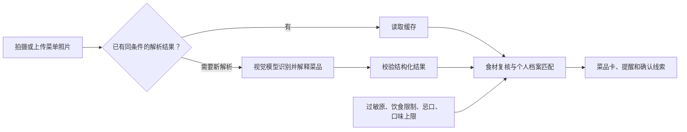

# As Your Dish 产品需求文档

> v1.0 公开版 · 面向跨语言点餐的菜单解析与饮食核对工作流

[目标用户与竞品分析](./research-and-competitive-analysis.md) · [在线体验原型](https://txxh-z.github.io/as-your-dish/) · [原型截图](../prototype/screens)

## 1. 问题与目标用户

在餐厅拿到外文菜单时，顾客要读出菜名，理解端上来的是什么，再判断点餐前要确认什么。以蘑菇烩饭为例，译名能说明菜的大致类型。做法、口味和配料线索能进一步帮助顾客决定是否要问店员有没有放黄油或奶酪。

| 用户 | 典型场景 | 需要完成的任务 |
| --- | --- | --- |
| 有饮食限制的旅行者 | 在陌生餐厅短时间内读一份外文菜单 | 找到可能涉及过敏原、忌口或饮食限制的菜，带着具体菜名和食材线索向店员确认 |
| 初到海外的留学生或旅居者 | 经常在食堂、简餐店和本地馆子看到陌生菜名 | 快速了解做法、食材和味道，并比较几道菜再点单 |

本期目标是把菜单照片整理为逐道可读、可比较的菜品卡，并在用户需要做决定时显示相关饮食提示。

## 2. 核心工作流

模型负责从照片中读出菜品，并解释原文菜名背后的做法、食材和可能味道。应用规定输出结构、校验结果，并运行食材词典和个人档案核对。同一张菜单的基础解析结果可复用，提醒按用户当前设置生成。

## 3. 版本范围与验收

| 优先级 | 需求 | 验收方式 |
| --- | --- | --- |
| P0 | 拍摄或上传 1–5 张菜单照片，服务端每张上限 5 MiB | 用已标注的多页菜单核对识别到的菜品数、顺序和重复项，同时覆盖超限输入 |
| P0 | 逐道展示原名、译名、做法、食材、过敏原、饮食标签、六维口味和识别置信度 | 用合法与缺字段的模型输出检验共享结构校验。支持纠错重试的适配器在修复失败后给出可操作的提示 |
| P0 | 按食材线索补查过敏原，并结合个人档案提醒 | 用带已知食材的样例验证模型漏标时的规则补充，并核对卡片上的依据。有档案匹配的过敏原或饮食限制以红色提示，忌口和口味超限以黄色提示 |
| P0 | 保存过敏原、饮食限制、忌口与口味上限 | 登录保存后重开同一份菜单，检查提示是否按当前档案重新计算 |
| P0 | 对相同照片和解析条件复用结果 | 相同图片、语言、服务商与模型下重复提交，检查是否命中缓存及复用结果。改变其中的解析条件，检查结果是否独立 |
| P0 | 控制模型调用成本，并提供自带密钥入口 | 验证匿名和注册用户的配额提示、缓存命中时的用量记录，以及用户选择自带密钥后的请求路径 |
| P1 | 中英韩语言切换、示例菜单、参考图、口味雷达图、历史记录与移动网页体验 | 逐项检查界面和菜品说明、无档案与有档案的显示差异，以及图片加载失败时卡片主体是否可用 |

当前交付包含两种可运行形态。React/Express 网页应用可接入视觉模型分析用户的照片。独立 HTML 原型使用预置样例演示同一条路径，提供意式小馆、韩国冰淇淋店、湘菜馆三个拍摄场景和 18 张对应的菜品参考图。右上角可以同时切换界面和菜品说明的语言。[本地运行方式](../../README.md#本地运行) · [在线体验原型](https://txxh-z.github.io/as-your-dish/)

## 4. 设计取舍与异常反馈

- **保留菜单原名。** 菜品解释让顾客理解内容，原名让顾客能把同一道菜指给店员看。
- **提示按性质区分。** 过敏原或饮食限制匹配需要优先看到。个人忌口与口味偏好用于比较。能匹配到食材时展示依据，便于顾客决定要确认什么。
- **参考图服务于理解。** 图像缺失时仍可阅读译名、食材和提示。参考图用于建立对菜品外观的预期。
- **先用预分析示例体验。** 读者能直接试完整交互，运营上可以复用样例结果和缓存，并按服务端配置管理调用配额。

| 情况 | 期望反馈 |
| --- | --- |
| 照片模糊、菜单太长或未提取到菜品 | 建议重拍、分开拍摄或调整照片范围 |
| 模型输出缺字段，纠错后仍校验失败 | 提示本次分析未完成，提供重新尝试入口 |
| 服务商不接受照片或额度已用完 | 提示选择可用的视觉服务商，或按界面指引提供密钥 |
| 食材信息有不确定性 | 保留原名和已有线索，引导顾客向店员确认食材与交叉接触情况 |

## 5. 评估与迭代

| 指标 | 统计口径 | 首轮目标 |
| --- | --- | --- |
| 解析成功率 | 能够通过字段校验并展示菜品的请求占比 | ≥95%，计划目标 |
| 菜品识别完整性 | 与人工标注的菜品清单对照，记录遗漏、重复和错认 | 先建立基线，按语言和图片质量分组 |
| 过敏提示质量 | 在人工标注样例上分别记录漏报、误报、证据是否可核对 | 现有规则使用九类应用标签，标注样例上的表现待验证 |
| 缓存命中率 | 命中复用结果的分析请求占比 | ≥20%，计划目标 |
| 单次分析成本 | 依据模型用量估算的新分析费用 | 均值 ≤ 0.10 美元，单次预算参考为 0.20 美元 |
| 点餐可用性 | 用户找到指定菜品及需要确认的食材所需时间 | 先建立基线，记录用户是否注意到提醒以及能否说出确认问题 |

上述数值用于设定验收与观测口径。后续优先验证长菜单、模糊照片和带酱汁描述的菜单，再依据等待时间、菜品遗漏和提醒质量决定是否做分段解析、店员沟通卡或按偏好推荐。 [菜单分析实现](../../backend/src/routes/analyzeMenu.ts) · [食材核对实现](../../backend/src/services/allergen.ts) · [菜品数据结构](../../shared/src/dish.schema.ts)
